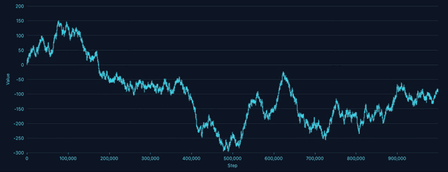

# swiftplot

<p>
  <picture>
    <source media="(prefers-color-scheme: dark)" srcset="https://raw.githubusercontent.com/GusevP/swiftplot/main/assets/logo-dark.svg" />
    
  </picture>
</p>

Small, fast charts on Canvas 2D and WebGL2. MIT, TypeScript, ESM only, no dependencies.

Examples, guides and the reference for every chart and option are at [swiftplot.dev](https://swiftplot.dev). Where the
project stands, what it lacks and what 1.0 needs: [swiftplot.dev/status](https://swiftplot.dev/status). Questions go to
[Discussions](https://github.com/GusevP/swiftplot/discussions).

**For AI coding assistants:** [`llms-full.txt`](https://swiftplot.dev/llms-full.txt) is a guide to writing code with
swiftplot, and [`llms.txt`](https://swiftplot.dev/llms.txt) its index.



```sh
npm install swiftplot                     # plain JavaScript
npm install swiftplot @swiftplot/react    # React 18.3 or 19
npm install swiftplot @swiftplot/vue      # Vue 3.4 or later
```

```ts
// <div id="chart" style="height: 320px"></div>
import { lineChart } from 'swiftplot/charts';

const rows = [
  { date: '2026-11-01', api: 120, web: 80 },
  { date: '2026-11-02', api: 132, web: 95 },
];
lineChart(document.getElementById('chart')!, { data: rows });
```

```tsx
import { LineChart } from '@swiftplot/react';

<LineChart data={rows} />;
```

```vue
<script setup lang="ts">
import { LineChart } from '@swiftplot/vue';
</script>

<template>
  <LineChart :data="rows" />
</template>
```

## Why it is fast

Each point comes from profiling uPlot, the fastest of the other twelve libraries in [chart-bench](https://github.com/gusevp/chart-bench) with the CPU slowed 4×, and timing the alternative.

- **Axis text is DOM, not canvas text.** uPlot's axis drawing cost 17–21 ms at 4× CPU slowdown at every data size.
- **Each mark has its own x column.** No aligned table, so no join step.
- **Step lines and bands are reduced to one min/max per pixel column** before the path is built.
- **Typed-array columns in, scale maths inlined** in the draw loops.
- **Scatter switches to WebGL2 at 20,000 points, bars, error bars, box plots and candlesticks at 10,000, and a sankey at 1,000 nodes and links together.** WebGL2 set-up costs about 4 ms, so a scatter on Canvas 2D mounts sooner below roughly 20,000 points. When the browser takes a WebGL context away, as it does with many WebGL charts on one page, that chart falls back to Canvas 2D.
- **Paths and GPU buffers are kept,** so a hover repaint never touches the data again.

## Measured

Mount time in chart-bench, median ms, 2026-11-26, Apple M3 Pro that was not idle. Each cell is one run of nine loads, each load a new page; the tables of 2026-11-24 were the mean of two runs with the libraries taking turns to go first. The 3 × 200, 6 × 1,000, 500 and 10,000 rows come from the run of all fourteen arms, whose [full table](https://github.com/gusevp/chart-bench#results) has the other libraries; the 10 × 10,000 and 100,000 rows from a [separate run of the two libraries](https://github.com/gusevp/chart-bench#large-data-swiftplot-and-uplot) on the same day. 4× is Chrome's CPU slowdown.

| case                     | swiftplot | uPlot | swiftplot, 4× | uPlot, 4× |
| ------------------------ | --------: | ----: | ------------: | --------: |
| survival, 3 × 200 points |      31.0 |  23.5 |          41.6 |      55.3 |
| survival, 6 × 1,000      |      26.1 |  28.4 |          50.7 |      69.0 |
| survival, 10 × 10,000    |      30.4 |  53.9 |          85.0 |     202.1 |
| scatter, 500             |      27.9 |  27.4 |          37.0 |      57.9 |
| scatter, 10,000          |      26.3 |  30.4 |          45.6 |      76.3 |
| scatter, 100,000         |      26.2 |  35.1 |          68.7 |     135.2 |

An empty page measured 20.6–25.4 ms at native speed and 15.0–23.2 ms at 4×, and the clock stops two frames after the chart is done, so a gap under one frame (16.7 ms) is a tie, and so, as chart-bench reads it, is a gap under 20% on a heavy chart. At native speed the two tie on every case but the 10 × 10,000 survival chart, where swiftplot is ahead. At 4× swiftplot is ahead on every case but the 3 × 200 survival chart, a tie.

Time until the chart's own code has finished, which leaves out the wait for the next frame:

| case                     | swiftplot | uPlot | swiftplot, 4× | uPlot, 4× |
| ------------------------ | --------: | ----: | ------------: | --------: |
| survival, 3 × 200 points |       6.3 |  10.6 |          24.1 |      43.4 |
| survival, 6 × 1,000      |       9.1 |  13.8 |          31.2 |      56.2 |
| survival, 10 × 10,000    |      18.5 |  49.3 |          65.6 |     186.8 |
| scatter, 500             |       4.7 |   9.1 |          19.4 |      45.2 |
| scatter, 10,000          |       7.7 |  12.3 |          28.7 |      60.9 |
| scatter, 100,000         |      15.6 |  30.4 |          48.7 |     118.4 |

- Every load is the first chart on a new page. The clock starts when the harness asks the loaded page to mount the chart, so loading and evaluating the library's code is not counted: these are first-mount times, not page startup.
- The 100k scatter runs on WebGL, where the draw call returns before the GPU finishes, so its numbers flatter swiftplot.
- uPlot has no built-in scatter, so its scatter numbers include circle-drawing code written for the benchmark.
- Only these two chart types are in the benchmark. Bars, areas, the time axis, the legend and animation are not measured against uPlot.

Gzip size of the minified bundle of each entry in `site/scripts/size/`, built from the packages' `dist` with Vite and measured by `pnpm size` into `site/scripts/size/sizes.json`, in KB. Each entry uses what it imports, so nothing it names is shaken out.

| entry              | imports                                                 |   KB |
| ------------------ | ------------------------------------------------------- | ---: |
| plot-line          | `plot` and `line` from `swiftplot`                      | 14.4 |
| plot-line-features | the same with `tooltip`, `legend`, `zoom` and `animate` | 19.1 |
| line-chart         | `lineChart` from `swiftplot/charts`                     | 37.6 |
| all-charts         | every chart of `swiftplot/charts`                       | 54.7 |
| react-line-chart   | `LineChart` from `@swiftplot/react`, React not counted  | 39.3 |
| vue-line-chart     | `LineChart` from `@swiftplot/vue`, Vue not counted      | 39.8 |

On chart-bench's page, which bundles `plot`, `line`, `area`, `ticks`, `dots`, `tooltip` and `animate`, swiftplot 0.5.0 adds 19.3 KB and uPlot 23.9 KB (`results/bundle.json`: the arm's page less the same page with no chart). uPlot ships more in its size: it is one module that comes whole, with its legend, cursor, selection and series types whether a page uses them or not.

Script time of one pan step, `propose()` of a window moved by a hundredth of its width (at the whole domain, one narrowed by a thousandth), median ms of 50, on an 800 × 400 chart, 2026-11-22, Apple M3 Pro, Chrome on Metal. Before → after is the remedy of the same date: a line or an area reads only the rows its window shows, and points on the canvas skip those that cannot reach the plot.

| case               |    100,000 |   1,000,000 |
| ------------------ | ---------: | ----------: |
| line, whole        |        0.9 |         5.1 |
| line, 10×          |        0.2 |         0.8 |
| line, 5000×        |  3.5 → 0.1 |  40.0 → 0.1 |
| area, whole        |        0.8 |         5.0 |
| area, 10×          |        0.2 |         0.8 |
| area, 5000×        |  5.0 → 0.0 |  55.8 → 0.1 |
| filled line, whole |        0.9 |         5.0 |
| filled line, 10×   |        0.2 |         0.9 |
| filled line, 5000× |        0.1 |         0.1 |
| filled area, whole |        0.8 |         4.9 |
| filled area, 10×   |        0.2 |         0.8 |
| filled area, 5000× |        0.0 |         0.1 |
| bars, whole        |        0.1 |         0.0 |
| bars, 10×          |        0.0 |         0.1 |
| bars, 5000×        |        4.9 |        61.0 |
| points, whole      |        0.1 |         0.0 |
| points, 10×        |        0.0 |         0.0 |
| points, 5000×      | 13.3 → 0.2 | 156.9 → 1.9 |

- Bars of 10,000 rows or more and points of 20,000 or more are drawn by WebGL, whose draw call returns before the GPU finishes, so their whole and 10× cells leave the drawing out. Magnified past 4096 times every mark is drawn on the canvas.
- A million bars at 5000× is over the 16 ms budget: the canvas still walks every bar.

The same step at 1,000,000 points with `fit: 'window'` on the y axis, 2026-11-22, beside the step without it in the same run (mean of two runs each). At the whole domain two windows narrowed by a thousandth and by two take turns, since one window repeated would be fitted once and kept.

| case          | without | with fit |
| ------------- | ------: | -------: |
| line, whole   |     4.8 |      7.0 |
| line, 10×     |     0.8 |      1.3 |
| line, 5000×   |     0.1 |      0.1 |
| area, whole   |     4.8 |      7.0 |
| area, 10×     |     0.9 |      1.3 |
| area, 5000×   |     0.1 |      0.1 |
| bars, whole   |     0.0 |      8.4 |
| bars, 10×     |     0.0 |      5.2 |
| bars, 5000×   |    55.4 |     63.8 |
| points, whole |     0.0 |      7.4 |
| points, 10×   |     0.1 |      3.8 |
| points, 5000× |     1.9 |      5.0 |

- A line or an area finds the rows in its window by binary search, so the fit costs the rows the window holds. Bars and points need not be in x order, so the fit reads every row.

## Licence

The code is MIT. The swiftplot name and logo are not covered by that licence.
